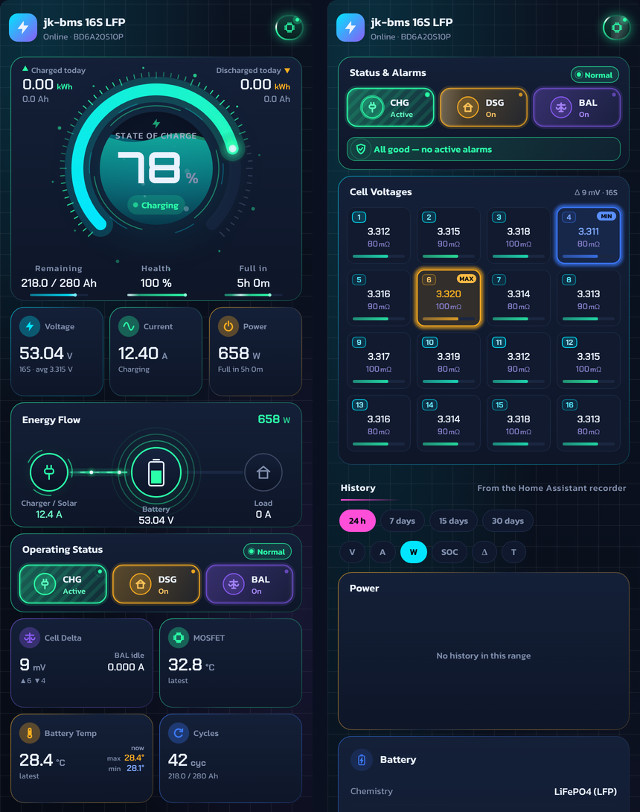

# AIG-LINK BMS Card

[](https://hacs.xyz/)
[](https://github.com/bunluesakplongyang-tech/aig-link-bms-card/releases)
[](https://www.buymeacoffee.com/giize)

A Home Assistant dashboard card for **JK-BMS** batteries connected through **ESPHome** ([syssi/esphome-jk-bms](https://github.com/syssi/esphome-jk-bms)).
Dashboard, BMS info (cell voltages, resistances, alarms, history) and BMS settings, all in one card. 7 languages: ไทย, English, 中文, Español, Português, Deutsch, Français.

การ์ดแดชบอร์ดสำหรับ Home Assistant ใช้ดูและตั้งค่า **JK-BMS** ที่ต่อผ่าน ESPHome (syssi) รองรับ 7 ภาษา



## Features

- Auto-detects every JK-BMS in Home Assistant (looks for `sensor.<prefix>_total_voltage`), up to 32 cells
- Three tabs: **Dashboard**, **BMS Info**, **Settings** — or show just one
- State of charge gauge, energy flow, charge/discharge/balance status, cell delta, temperatures, cycles
- Cell voltage grid with min/max highlight and cell resistance
- History charts from the Home Assistant recorder
- Change BMS parameters from the Settings tab (can be disabled with `readonly: true`)
- 4 themes: AIG Neon, Carbon Volt, Solar Flare, Synthwave
- Visual editor — no YAML needed
- Shows only the temperature sensors your BMS actually reads

## Requirements

- Home Assistant with a JK-BMS integrated through ESPHome using **syssi/esphome-jk-bms**
- Entities keep their default names, e.g. `sensor.jk_bms_total_voltage`, `sensor.jk_bms_cell_voltage_1` (any prefix works)

## Installation

### HACS (recommended)

[](https://my.home-assistant.io/redirect/hacs_repository/?owner=bunluesakplongyang-tech&repository=aig-link-bms-card&category=plugin)

Or manually in HACS:

1. HACS → ⋮ (top right) → **Custom repositories**
2. Repository: `https://github.com/bunluesakplongyang-tech/aig-link-bms-card` — Type: **Dashboard**
3. Search **AIG-LINK BMS Card** → **Download**
4. Reload the browser

### Manual

1. Copy `dist/aig-link-bms-card.js` to `<config>/www/`
2. Settings → Dashboards → ⋮ → **Resources** → add `/local/aig-link-bms-card.js` as **JavaScript module**
3. Reload the browser

## Usage

Edit a dashboard → **Add card** → search **AIG-LINK BMS**. The card picks your BMS automatically.

```yaml
type: custom:aig-link-bms-card
prefix: jk_bms
```

| Option | Default | Description |
|---|---|---|
| `prefix` | auto | Entity prefix of the BMS (`sensor.<prefix>_total_voltage`) |
| `name` | device name | Title shown in the header |
| `view` | `full` | `full` (3 tabs), `dashboard`, `info`, `settings` |
| `theme` | `neon` | `neon`, `carbon`, `solar`, `synth` |
| `language` | `auto` | `auto` (follows Home Assistant), `th`, `en`, `zh`, `es`, `pt`, `de`, `fr` — or pick it from the chip button menu in the card |
| `protocol` | auto | `JK04`, `JK02_24S`, `JK02_32S` |
| `background` | `true` | Show the card background |
| `header` | `true` | Show the header |
| `readonly` | `false` | Hide controls that change BMS settings |

> ⚠️ The Settings tab writes values straight to your BMS. Wrong protection values can damage batteries — change them only if you know what they do.

## Support

If this card is useful to you, you can buy me a coffee ☕

<a href="https://www.buymeacoffee.com/giize" target="_blank"></a>

Bugs and ideas: [open an issue](https://github.com/bunluesakplongyang-tech/aig-link-bms-card/issues).

## License

MIT
